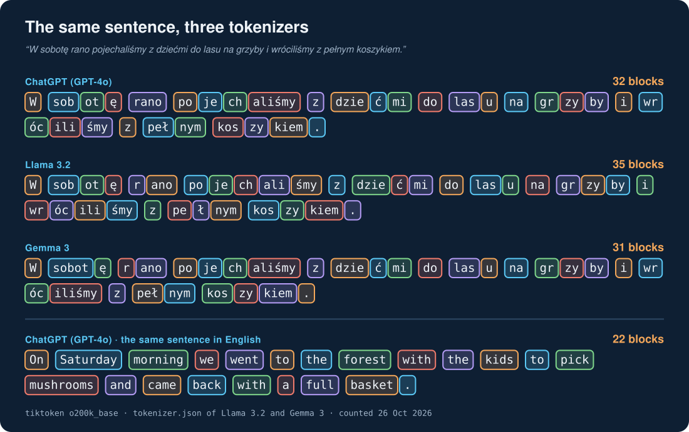
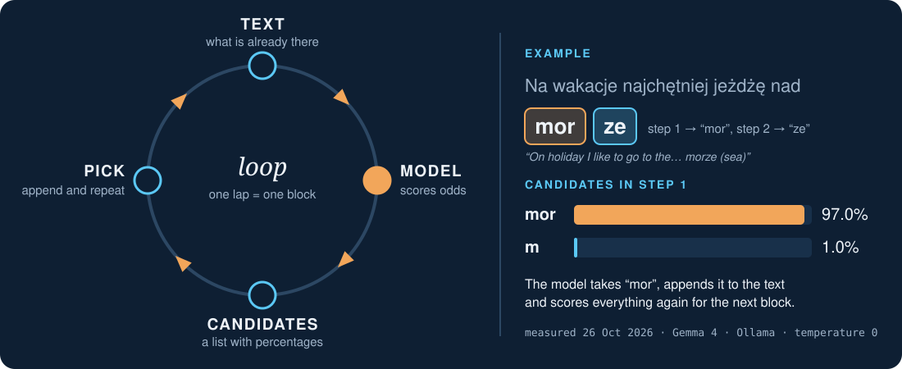
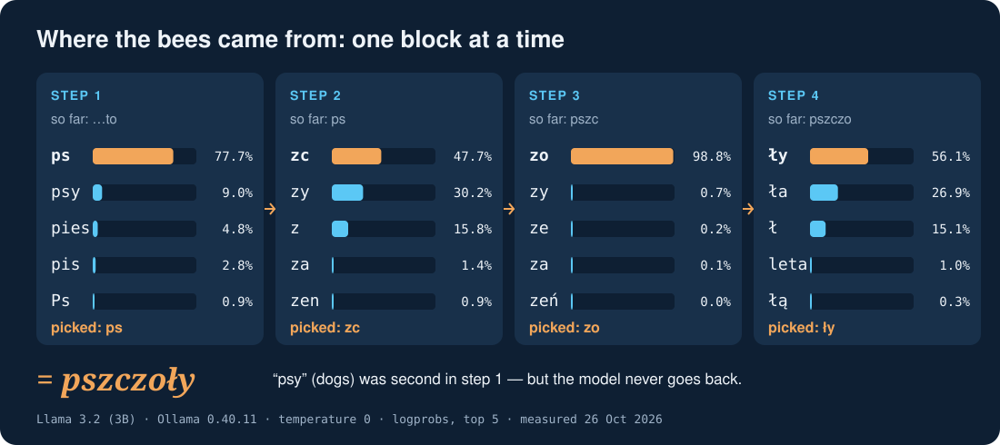
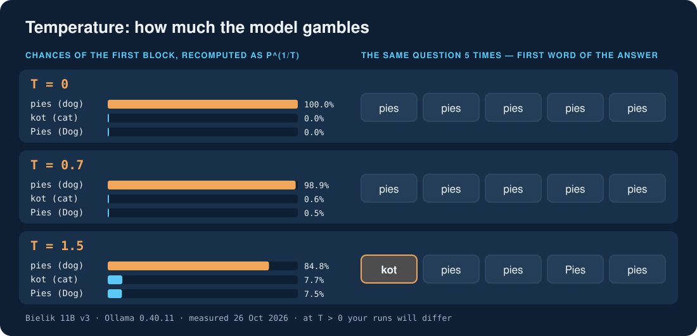

# 🧠 AI from Scratch #1 — What an LLM is and what tokens are

[]()
[](https://youtu.be/EGYjK3ZXgjY)
[]()
[]()

> 🎯 After this guide you know what happens inside when an AI chat "writes" an answer: text is cut into blocks
> (tokens), the model guesses the next block, and temperature decides how much it gambles. You also know why Polish
> costs more tokens than English and why AI can say something made up in a confident tone. 🇵🇱 [Wersja polska](01-llm-and-tokens_PL.md)

> 📺 Video (in Polish, English audio track): [AI from Scratch #1](https://youtu.be/EGYjK3ZXgjY) · chapters: [tokens 2:00](https://youtu.be/EGYjK3ZXgjY?t=120) · [hallucinations 3:34](https://youtu.be/EGYjK3ZXgjY?t=214) · [temperature 4:46](https://youtu.be/EGYjK3ZXgjY?t=286)

**Checked on:** Ollama 0.40.11 · Bielik 11B v3 · Gemma 4 · Llama 3.2 (3B) · tokenizers GPT-4o (`o200k_base`),
Llama 3.2, Gemma 3 · measured 26 Oct 2026. On 27 Oct 2026 we walked through the whole "Try it yourself" again **on a clean
Windows 10 22H2** (Windows PowerShell 5.1, no graphics card, nothing installed beforehand) — every result matched.

The prompts are in Polish on purpose — the series is Polish and the token cost of Polish is part of the story.
English translations are given next to them.

---

## 🎬 What the video showed (in short)

1. An LLM is "phone keyboard suggestions" at a huge scale: it guesses what comes next.
2. An answer is built in a loop: text → the model scores candidates → picks a block → appends it → again.
3. The model does not see letters or words, only **tokens** (blocks). Polish needs more of them than English.
4. Training sets billions of "knobs" (weights); during a chat they are frozen.
5. Made-up answers (hallucinations) come from picking the block that *fits*, not checking what is *true*.
6. Temperature sets how much the model gambles.

## 📖 Words you need

LLM · token · tokenizer · probability · weight · training · hallucination · temperature — short definitions in the
[glossary](glossary.md).

## 🧱 1. Tokens: how text turns into blocks

Before the model "reads" anything, the text goes through a **tokenizer** — the part that cuts it into blocks from a
fixed vocabulary. The vocabulary is built once, before training: the most frequent pieces of text get a block of their
own. Since most of the text was English, English words usually fit in one block ("mushrooms", "Saturday"). Polish
words, with their endings and letters like "ą, ę, ż", more often have to be put together from several pieces:
"jeżdżę" is "je | ż | d | ż | ę" in GPT-4o. The space usually belongs to the block that follows it (" rano",
" las"). Each model family has its own vocabulary, which is why the same sentence gives different numbers in each
column of the table.

**Measured — how many blocks the same sentence takes (PL / EN):**

| Sentence | GPT-4o | Llama 3.2 | Gemma 3 |
|---|---|---|---|
| "W sobotę rano pojechaliśmy z dziećmi do lasu na grzyby i wróciliśmy z pełnym koszykiem." (*On Saturday morning we went to the forest with the kids to pick mushrooms and came back with a full basket.*) | **32 / 22** | 35 / 22 | 31 / 22 |
| "Na wakacje najchętniej jeżdżę nad morze." (*On holiday I like to go to the seaside most.*) | 17 / 11 | 18 / 11 | 16 / 11 |
| "Najlepsze zwierzę domowe to pies." (*The best pet is a dog.*) | 12 / 7 | 13 / 7 | 10 / 7 |

- Polish takes **1.4 to 1.9 times more** blocks than English (depending on the sentence and the model; rounded in the
  video to "one and a half to two times").
- "Jeżdżę" (*I drive*) is **5 blocks** in GPT-4o; "pies" and "dog" are one block each.
- The English audio track of the video says the sentence more freely: "On Saturday morning we went mushroom picking
  with the kids and came back with a full basket." That version is **18** blocks in GPT-4o. The 22 in the video and in
  the table is for the translation above — paste that one to get our number.



**What it means for you:** chat limits, API costs and how much of a conversation the model can "hold" are counted in
tokens — in Polish the same conversation reaches the limit sooner. That is no reason to stop using Polish; it is just
good to know.

An example with the numbers from the table: a conversation that would take 1,000 blocks in English takes roughly
1,400–1,900 in Polish. If a chat has a message limit counted in tokens, or you pay per token in an API, you fit less
content into it in Polish. The same goes for the conversation's "memory" — more on that in episode 2. We give no
prices: they change more often than this guide.

## 🎯 2. Guessing the next block

The model does not "know" which word comes next. At every step it computes a **chance in percent** for every block in its
vocabulary at once (128,256 blocks in Llama 3.2) — all chances together add up to 100%. Then it picks one block, appends it to the text and
computes everything again, now with the new block. A chat answer is a few hundred such laps of the loop, which is why
it appears on screen piece by piece. Ollama can show the five best candidates at each step — that is exercise 2 below.



**Measured — the first block of the answer (temperature 0):**

| Start of the sentence | Bielik 11B v3 | Gemma 4 | Llama 3.2 (3B) |
|---|---|---|---|
| "Najlepsze zwierzę domowe to…" (*The best pet is…*) | **pies** (*dog*; "p" 84.1%) | **Zależy** (*It depends*; "Z" 23.1%) | **pszczoły** (*bees*; "ps" 77.7%) |
| "Na wakacje najchętniej jeżdżę nad…" (*On holiday I like to go to the…*) | morze (*sea*; "mor" 61.9%) | morze ("mor" 97.0%) | morską (*sea-*, adjective; "m" 72.8%) |

The same block "mor" is picked with 97% confidence by one model and 62% by another — models differ not only in the
answer but in how "sure" they are of it.

## 🐝 3. Where the bees came from (step by step)

| Step | Text so far | Candidates (Llama 3.2, temperature 0) | Pick |
|---|---|---|---|
| 1 | "…to" | "ps" 77.7% | ps |
| 2 | "ps" | "zc" 47.7% · "zy" 30.2% | **zc** — almost a coin toss |
| 3 | "pszc" | "zo" 98.8% | zo |
| 4 | "pszczo" | "ły" 56.1% | ły → **pszczoły** (*bees*) |



"psy" would have meant *dogs*. The model cannot go back: once it picked "zc", the best-fitting continuation was bees,
not dogs.

The same happens with everyday questions. The model picks blocks that **fit**, so a date, a name, a number or a book
title can look believable and be untrue — in exactly the same confident tone as the truth. Such made-up answers are
called hallucinations.

**How to check (an everyday list):**

- Facts, numbers, dates, names, quotes and links — check them at the source before you use them.
- Ask for the source and open it. A link that does not work, or says something else, is a warning sign.
- Ask the same question in a new conversation or another model. Different answers = the model is guessing.
- The rarer the topic (a small town, a niche regulation, a fresh event), the more careful you should be.
- A confident tone is not proof.

## 🧊 4. Training vs using

Inside the model there are billions of numbers — **weights**. In the video they are "knobs": each one shifts the chances
of the blocks a little. **Training** is the long process of setting those knobs on a huge amount of text, done once,
before the model reaches people. After that the knobs are frozen: while you chat, the model does not learn and does not
look anything up in a database of facts; it only computes chances from what is in its weights. That is why it does not
know what happened after training ended — that moment is called the **knowledge cut-off**. You can see it in our numbers:
the Llama 3.2 model file is 2.0 GB, and at temperature 0 (after `ollama stop`) it gives exactly the same percentages every time — nothing in it
changes between questions.

**What the video did not say:** many chat apps add tools around the model — web search, reading your files, keeping notes
about you. Then an answer can include fresh information, but the model's weights still do not change: the app simply
pastes the text it found into the conversation. How this works: episode 2 (context) and 4 (from chat to agent). The
local model in Ollama used in this guide has no such tools.

## 🌡️ 5. Temperature

**Formula (optional):** the chance of a block at temperature T is p^(1/T), rescaled so that all chances add up to 100%.
As T → 0 the top block gets 100%; the higher T, the more even the chances.

Example from the measurement (Bielik, top 3 first-word blocks, recomputed):

| Temperature | "p…" (pies, *dog*) | "k…" (kot, *cat*) | "P…" (Pies) |
|---|---|---|---|
| 0 | 100% | 0% | 0% |
| 1.5 | 84.8% | 7.7% | 7.5% |



**Measured — the same question 5 times ("Najlepsze zwierzę domowe to…", first word of the answer):**

| Model | T = 0 | T = 0.7 | T = 1.5 |
|---|---|---|---|
| Bielik 11B v3 | pies ×5 | pies ×5 | **kot**, pies, pies, Pies, pies |
| Gemma 4 | Zależy ×5 | Zależy / To zależy | To zależy, Idealne, tobie, **sobój** (not a word), Zależy |
| Llama 3.2 (3B) | pszczoły ×5 | pszy, pszy, psy, pszczoły, pszczoły | psy, psy, pszy, pszy, pies |

At temperature 0 the result is the same every time; at higher values it changes on every run — your results will
differ, and that is fine.

**Other sampling knobs (optional).** Besides temperature, Ollama has, among others, **`top_k`** — sample only among the
k best blocks (default 40) — and **`top_p`** — take the best blocks until their chances add up to p (default 0.9); lower
values give more cautious answers, higher ones more varied answers. There is also **`seed`**: the same number with the same
question gives the same text even when sampling. Note: a model can have **its own defaults**. Check them with
`ollama show <model> --parameters` — for us Bielik has `temperature 0.1`, Gemma 4 `temperature 1`, `top_k 64`,
`top_p 0.95`, and Llama 3.2 sets nothing, so Ollama uses its own `temperature 0.8`. That is why `ollama run llama3.2`
can answer "pszczółka" instead of "pszczoły" (see the installation section).

## 🗄️ From my work

"Najlepsza baza danych to…" (*The best database is…*): Bielik — **PostgreSQL**, Llama 3.2 — **MySQL**, Gemma 4 — starts
by repeating the question. Three models, three different "confident" answers — which is why I check every script from AI
before I run it.

Now look inside: Bielik picked "Post" (the start of "PostgreSQL") with a chance of only **25.7%**, and Llama picked
"MySQL" with **17.1%**. In a chat the answer would look just as confident as "pies" (*dog*) at 84%, while the model was
far from sure. In my day job I am a database administrator, and AI really helps me — it writes scripts and hunts for
bugs. But a script meant to run on a real database I first read and try on a test one. Every AI answer about something
important deserves the same treatment.

## 🛠️ Try it yourself

### Level 1 — no install

#### Exercise A — a tokenizer in the browser (the link from the video)

1. Open **https://platform.openai.com/tokenizer** — OpenAI's official tool, no login needed (you can close the cookie
   banner with the reject button).
2. Keep the first tab selected, **"GPT-5.x & O1/3"**. There is no tab named GPT-4o, but this one gives exactly the same
   split as GPT-4o in the video — we checked it on all three examples below. The "legacy" tabs are older models and
   count differently.
3. Paste a sentence and read **Tokens** and **Characters**. Under the counter you see coloured blocks — the same as in
   the video (the **Token IDs** switch shows the block numbers instead).

| Paste | Our output (Tokens / Characters) |
|---|---|
| `W sobotę rano pojechaliśmy z dziećmi do lasu na grzyby i wróciliśmy z pełnym koszykiem.` | **32** / 87 |
| `On Saturday morning we went to the forest with the kids to pick mushrooms and came back with a full basket.` | **22** / 107 |
| `jeżdżę` | **5** / 6 |

Checked on 26 Oct 2026. Paste the text (Ctrl+V), do not retype it — one typo and the numbers will not match.

**Do the maths:** OpenAI says on that page that in English text one token is about 4 characters on average. Our
sentence gives: English 107 / 22 ≈ **4.9** characters per block, Polish 87 / 32 ≈ **2.7**. The same text in Polish is
simply "more expensive" in tokens. Paste a few sentences of your own (an e-mail, a message, a recipe) and compare.

#### Exercise B — the same question several times

Ask an AI chat (any) the same question 3–5 times, **each time in a new conversation**, e.g. "Finish the sentence with
one word: The best pet is". Write the answers down. Chats usually gamble a little (temperature above zero), so the answers may
differ — exactly as in the video.

### Level 2 — a local model (Ollama): exactly our commands and our output

Below are **exactly the requests, with the same parameters**, that produced the numbers in the video. Under each command
is **our output**, copied from a real run (26 Oct 2026, Ollama 0.40.11, Windows 11, NVIDIA GPU). Run it yourself and compare.

> ⚠️ **Non-English characters.** The request is sent as a UTF-8 JSON file (Bash) or as UTF-8 bytes (PowerShell).
> Pasting Polish text straight into a `curl` argument in Git Bash can break the letters — the model then gets different
> text and the results are wrong (that is what happened in our first attempt).

#### 0. Installing Ollama and the models

[Ollama](https://ollama.com) is a free program that runs language models **on your own computer** — no account, no text
sent to the internet (you need the internet only to download the program and the models). It runs in the background and
answers at `http://localhost:11434`. It also works on the CPU alone, just slower than with a graphics card.

**Windows** (10 22H2 or newer, 11) — pick one way:

```powershell
# A) downloadable installer (simplest, no administrator rights needed):
#    https://ollama.com/download -> OllamaSetup.exe -> run it

# B) PowerShell — the official script (downloads and runs the same OllamaSetup.exe):
irm https://ollama.com/install.ps1 | iex

# C) winget (the Windows package manager):
winget install --id Ollama.Ollama --exact
```

> 🛡️ Way B runs a script straight from the internet. A good habit (it comes back in the safety episode): read it first —
> `irm https://ollama.com/install.ps1` prints it to the screen without running anything. What is inside (checked on
> 27 Oct 2026): it downloads `OllamaSetup.exe`, **checks its digital signature** (it must be "Ollama Inc.", otherwise it
> stops), installs it silently for your account only (`%LOCALAPPDATA%\Programs\Ollama`, no administrator rights) and starts
> Ollama in the background. The long `# SIG # Begin signature block` at the end is the script's own signature — no need to read it.

**Our output for way B** (clean Windows 10, about 5 minutes, no window, no questions):

```text
>>> Downloading Ollama for Windows...
######################################## 100.0%
>>> Installing Ollama...
>>> Install complete. Run 'ollama' from the command line.
```

After installing, Ollama runs in the background; its icon (a llama) sits next to the clock — on Windows 10 usually
**hidden under the ^ arrow**.

**macOS:** download `Ollama.dmg` from https://ollama.com/download or, in Terminal:

```bash
curl -fsSL https://ollama.com/install.sh | sh
```

**Linux:**

```bash
curl -fsSL https://ollama.com/install.sh | sh
```

**Check that it works** — Windows (PowerShell):

```powershell
ollama --version
curl.exe -s http://localhost:11434/api/version
```

macOS / Linux (Bash): the same, just `curl -s` instead of `curl.exe -s`.

**Our output:** `ollama version is 0.40.11` and `{"version":"0.40.11"}`. You need a version that supports `logprobs`,
i.e. **0.12.11 or newer** (we had 0.40.11 and checked every command below with it). On Windows type **`curl.exe`**: in Windows PowerShell 5.1
(the one that comes with the system) plain `curl` is a different command and asks for `Uri:` instead of answering
(see "Common mistakes").

**Download the models used in the episode** (once; sizes from our `ollama list`):

```powershell
ollama pull llama3.2                                    # 2.0 GB
ollama pull SpeakLeash/bielik-11b-v3.0-instruct:Q4_K_M  # 6.7 GB — a Polish model
ollama pull gemma4                                      # 9.6 GB — optional
ollama list
```

Each download ends with `verifying sha256 digest`, `writing manifest`, `success`. With a big model **`verifying sha256
digest` can sit for several to over ten minutes with no progress bar** (Ollama checks that the whole file arrived) — it is
not frozen, don't stop it. On a clean Windows 10 in a virtual machine: Llama 3.2 took about 3.5 minutes, Bielik about
25 minutes (about 13 of them just the check).

Models go to the `.ollama` folder in your home folder; set the `OLLAMA_MODELS` environment variable to use another place
(then quit and restart Ollama).

**First conversation:**

```powershell
ollama run llama3.2 "Dokończ zdanie jednym słowem: Najlepsze zwierzę domowe to"
```

**Our output:** `pszczółka.` (*little bee*) — while the video said "pszczoły" (*bees*); on a second computer we got
`pszy.` and then `pszczoła.` (*a bee*). Not a mistake: `ollama run` uses
the model's default settings, including a temperature above zero, so it gambles a little. That is why the exercises below
ask through the API with `temperature: 0` — the only way to compare your result with ours to the percent.

The Bash version of the exercises also needs `jq` (readable output from JSON): Linux `sudo apt install jq`, macOS
`brew install jq`, Windows `winget install jqlang.jq`.

#### Exercise 1 — how many tokens a sentence has (Llama 3.2)

`raw: true` sends the text without the chat wrapping, so Ollama counts only our sentence **plus 1 start token**.

**PowerShell**

```powershell
$body = @{
  model   = "llama3.2"
  prompt  = "W sobotę rano pojechaliśmy z dziećmi do lasu na grzyby i wróciliśmy z pełnym koszykiem."
  raw     = $true
  stream  = $false
  options = @{ num_predict = 1 }
} | ConvertTo-Json -Depth 5
$r = Invoke-RestMethod -Uri "http://localhost:11434/api/generate" -Method Post `
       -ContentType "application/json; charset=utf-8" -Body ([Text.Encoding]::UTF8.GetBytes($body))
"prompt_eval_count = $($r.prompt_eval_count)  ->  tokens = $($r.prompt_eval_count - 1)"
```

**Bash** (Linux, macOS, Git Bash)

```bash
cat > count.json <<'EOF'
{
  "model": "llama3.2",
  "prompt": "W sobotę rano pojechaliśmy z dziećmi do lasu na grzyby i wróciliśmy z pełnym koszykiem.",
  "raw": true,
  "stream": false,
  "options": { "num_predict": 1 }
}
EOF
curl -s http://localhost:11434/api/generate -H "Content-Type: application/json" \
     --data-binary @count.json | jq '.prompt_eval_count - 1'
```

A pasted PowerShell block shows `>>` at the start of the following lines — that just means "the command continues", not an error.

**Our output:** `prompt_eval_count = 36  ->  tokens = 35` (Bash: `35`) — the same as the Llama 3.2 column in the table.
This number does not depend on the computer: a clean Windows 10 with no graphics card gave the same.
Swap in the English sentence from the table: you get **22**.

#### Exercise 2 — next-block candidates: where the bees came from (Llama 3.2)

`logprobs` + `top_logprobs: 5` makes Ollama return the 5 best candidates at every step, `temperature: 0` switches
randomness off, `num_predict: 4` = 4 answer blocks. The prompt means *"Finish the sentence with one word: The best pet is"*.

> 💡 **Run `ollama stop llama3.2` first.** If you ask the same question a second time without stopping the model, Ollama
> reuses the cached start of the conversation and computes it slightly differently: we then got 78.1% → 45.4% instead of
> 77.7% → 47.7%. The answer ("pszczoły", *bees*) stays the same; only the last digits change. On another computer
> (a different GPU, CPU only) the percentages may differ by a few points too — what matters is the answer and the order
> of the main candidates. Candidates with almost equal chances (e.g. 1.2% and 1.2%) may swap places.
> A different version of Ollama or of the model moves the percentages as well: on the same laptop, after Ollama
> updated itself from 0.40.11 to 0.40.13 (30 Oct 2026), we got "ły" 49.1% instead of 56.1% and "ps" 76.2% instead
> of 77.7%. The answers at T = 0 and the order of the candidates stayed the same.

**PowerShell**

```powershell
ollama stop llama3.2
$body = @{
  model        = "llama3.2"
  prompt       = "Dokończ zdanie jednym słowem: Najlepsze zwierzę domowe to"
  stream       = $false
  think        = $false
  logprobs     = $true
  top_logprobs = 5
  options      = @{ num_predict = 4; temperature = 0 }
} | ConvertTo-Json -Depth 5
$r = Invoke-RestMethod -Uri "http://localhost:11434/api/generate" -Method Post `
       -ContentType "application/json; charset=utf-8" -Body ([Text.Encoding]::UTF8.GetBytes($body))
"Answer: $($r.response)"
foreach ($step in $r.logprobs) {
  ($step.top_logprobs | ForEach-Object { "{0} {1:N1}%" -f $_.token, ([math]::Exp($_.logprob) * 100) }) -join "  |  "
}
```

**Bash**

```bash
ollama stop llama3.2
cat > request.json <<'EOF'
{
  "model": "llama3.2",
  "prompt": "Dokończ zdanie jednym słowem: Najlepsze zwierzę domowe to",
  "stream": false,
  "think": false,
  "logprobs": true,
  "top_logprobs": 5,
  "options": { "num_predict": 4, "temperature": 0 }
}
EOF
curl -s http://localhost:11434/api/generate -H "Content-Type: application/json" \
     --data-binary @request.json > response.json
jq -r '.response' response.json
jq -r '.logprobs[] | [.top_logprobs[] | "\(.token) \((.logprob | exp) * 1000 | round / 10)%"] | join("  |  ")' response.json
```

**Our output** (PowerShell on a Polish Windows prints a decimal comma; Bash prints `77.7%`, `9%`):

```text
Answer: pszczoły
ps 77,7%  |  psy 9,0%  |  pies 4,8%  |  pis 2,8%  |  Ps 0,9%
zc 47,7%  |  zy 30,2%  |  z 15,8%  |  za 1,4%  |  zen 0,9%
zo 98,8%  |  zy 0,7%  |  ze 0,2%  |  za 0,1%  |  zeń 0,0%
ły 56,1%  |  ła 26,9%  |  ł 15,1%  |  leta 1,0%  |  łą 0,3%
```

The whole video in four lines: "psy" (*dogs*) was second (9%), and in step two "zc" beat "zy" almost by a coin toss.

**Our output on the CPU alone** (clean Windows 10, no graphics card) — the same answer, the same three main candidates
at every step, percentages 0.2–3 points off, and in step two places 4 and 5 swapped (almost a tie):

```text
Answer: pszczoły
ps 76,6%  |  psy 10,2%  |  pies 4,6%  |  pis 2,6%  |  Ps 1,2%
zc 46,8%  |  zy 32,0%  |  z 14,1%  |  zen 1,2%  |  za 1,2%
zo 99,0%  |  zy 0,6%  |  ze 0,2%  |  za 0,1%  |  zeń 0,0%
ły 53,0%  |  ła 29,4%  |  ł 15,8%  |  leta 0,9%  |  łą 0,3%
```
Change `model` to `SpeakLeash/bielik-11b-v3.0-instruct:Q4_K_M` (answer: **pies**, *dog*, "p" 84.1%; Bielik's first
step is a new line) or `gemma4` (answer: **Zależy**, *it depends*).

#### Exercise 3 — temperature: the same question 5 times (Bielik 11B)

**PowerShell**

```powershell
foreach ($t in 0, 1.5) {
  $body = @{
    model   = "SpeakLeash/bielik-11b-v3.0-instruct:Q4_K_M"
    prompt  = "Dokończ zdanie jednym słowem: Najlepsze zwierzę domowe to"
    stream  = $false
    think   = $false
    options = @{ num_predict = 12; temperature = $t }
  } | ConvertTo-Json -Depth 5
  "T = $t"
  1..5 | ForEach-Object {
    $r = Invoke-RestMethod -Uri "http://localhost:11434/api/generate" -Method Post `
           -ContentType "application/json; charset=utf-8" -Body ([Text.Encoding]::UTF8.GetBytes($body))
    "  " + ($r.response.Trim() -split "`n")[0]
  }
}
```

**Bash**

```bash
for T in 0 1.5; do
  cat > temp.json <<EOF
{
  "model": "SpeakLeash/bielik-11b-v3.0-instruct:Q4_K_M",
  "prompt": "Dokończ zdanie jednym słowem: Najlepsze zwierzę domowe to",
  "stream": false,
  "think": false,
  "options": { "num_predict": 12, "temperature": $T }
}
EOF
  echo "T = $T"
  for i in 1 2 3 4 5; do
    curl -s http://localhost:11434/api/generate -H "Content-Type: application/json" \
         --data-binary @temp.json | jq -r '.response | ltrimstr("\n") | split("\n")[0]'
  done
done
```

**Our output** (one of our runs, 26 Oct 2026 in the evening):

```text
T = 0
  pies. Pies jest najlepszym przy
  pies. Pies jest najlepszym przy
  pies. Pies jest najlepszym przy
  pies. Pies jest najlepszym przy
  pies. Pies jest najlepszym przy
T = 1.5
  pies.
  Pies.
  pies. Pies jest często uważ
  pies. Pies jest często uważ
  Pies. Jest to najczęśc
```

At T = 0 the result is identical every time — on the CPU alone too (clean Windows 10: five times
`pies. Pies jest najlepszym przy`, the whole exercise about 2 minutes including loading the model). At T = 1.5 **your result will differ from ours**, and from run to run —
that is the randomness. In the measurement for the video "kot" (*cat*) came up once; in the run above it did not, and in
the Bash test the same evening it did again ("kot. Koty są niezależne"). The answers stop mid-word because
`num_predict: 12` cuts them after 12 blocks — we only needed the first word.

#### Exercise 4 — ChatGPT (GPT-4o) blocks in Python

This exercise needs **Python**. Check whether you have it: `python --version`. On a clean Windows you get
`Python was not found; run without arguments to install from the Microsoft Store…` instead of a version (Windows itself
suggests the Microsoft Store). Install it with one command:

```powershell
winget install --id Python.Python.3.12 --exact
```

(macOS: `brew install python`; Linux usually has Python — `python3 --version`.) The first time, `winget` may ask you to
accept the `msstore` source terms — answer `Y`. After installing, **close PowerShell and open it again** — in the old
window `python` still shows the Store message. In the new one `python --version` → `Python 3.12.10` (about 2 minutes for us).

Then the library with the GPT-4o tokenizer:

```powershell
python -m pip install tiktoken
```

At the end you may see `[notice] A new release of pip is available…` — just information, you can ignore it.

Save the code as `gpt4o_tokens.py` (in Notepad: *Save as* → type "All files", encoding UTF-8) and run `python gpt4o_tokens.py`:

```python
import tiktoken

enc = tiktoken.get_encoding("o200k_base")          # the tokenizer of GPT-4o
for text in ["W sobotę rano pojechaliśmy z dziećmi do lasu na grzyby i wróciliśmy z pełnym koszykiem.",
             "On Saturday morning we went to the forest with the kids to pick mushrooms and came back with a full basket.",
             "jeżdżę"]:
    ids = enc.encode(text)
    print(len(ids), "|".join(enc.decode([i]) for i in ids))
```

**Our output:**

```text
32 W| sob|ot|ę| rano| po|je|ch|aliśmy| z| dzie|ć|mi| do| las|u| na| gr|zy|by| i| wr|óc|ili|śmy| z| peł|nym| kos|zy|kiem|.
22 On| Saturday| morning| we| went| to| the| forest| with| the| kids| to| pick| mushrooms| and| came| back| with| a| full| basket|.
5 je|ż|d|ż|ę
```

This output does not depend on your computer: a tokenizer is a fixed table, so you must get **exactly** the same.

**Scripted path** — every measurement from the video with one command: [`episodes/01-llm-and-tokens/`](../episodes/01-llm-and-tokens/) (`tokens.py`, `next_token.py`, how to run them in that folder's README).
We checked it ourselves: a re-run on 26 Oct 2026 gave **identical** counts, candidates and temperature-0 answers
to the measurement for the video (only the runs at T > 0 differed — as they should). That was with the same
Ollama 0.40.11. After an update to 0.40.13 (30 Oct 2026) the counts, the order of the candidates and the
temperature-0 answers were still identical, but the percentages of Llama 3.2 and Bielik moved by up to a few
points (Gemma 4: unchanged) — the numbers in the video are a snapshot of one version.

## ⚠️ Common mistakes

Collected while preparing this guide (26 Oct 2026) and during the test on a clean Windows 10 (27 Oct 2026).

| What you see | Why | What to do |
|---|---|---|
| `{"error":"model 'llama3.3' not found"}` | the model is not pulled, or a typo in the name | `ollama list`, then `ollama pull <name>` |
| `Error: pull model manifest: file does not exist` (with `ollama run`) | there is no such model in the Ollama library | check the name at ollama.com/library |
| `curl` prints nothing (exit code 7); PowerShell: "No connection could be made because the target machine actively refused it" | Ollama is not running | start the Ollama app (Windows: the icon next to the clock) or `ollama serve` |
| the percentages differ from ours in the last digits (e.g. 78.1% instead of 77.7%) | the same question asked a second time — Ollama used its cache | `ollama stop <model>` and repeat |
| the percentages differ from ours by a few points, the answer is the same | another version of Ollama or of the model (`ollama pull` fetches the newest) | nothing to fix — compare the answer and the order of the candidates, not the last digits |
| more tokens than in the table, odd characters instead of "ą, ę" | Polish text pasted straight into `curl` in Git Bash | send it from a JSON file (`--data-binary @file`) or from PowerShell |
| `ollama run` gives a different answer than the video | the model's default temperature is above 0 | compare through the API with `"temperature": 0` (exercises 2–3) |
| no `logprobs` field in the response | Ollama too old — `logprobs` arrived in version **0.12.11** (November 2025) | `ollama --version`, update Ollama; we had 0.40.11 |
| the browser tokenizer shows a different number | another tab, or the text was retyped instead of pasted | the "GPT-5.x & O1/3" tab, paste with Ctrl+V |
| after `curl -s …` PowerShell prints `Supply values for the following parameters:` and waits at `Uri:` | in Windows PowerShell 5.1 `curl` is a different command (`Invoke-WebRequest`) | Ctrl+C, then `curl.exe -s …` |
| `ollama pull` sits on `verifying sha256 digest` for a long time | Ollama is checking the big model file, with no progress bar | wait (up to about 13 minutes for us), don't stop it |
| no Ollama icon next to the clock | Windows hides new icons | click the ^ arrow next to the clock |
| `Python was not found; run without arguments to install from the Microsoft Store…` | no Python yet, or you installed it in the same window | `winget install --id Python.Python.3.12 --exact`, then a **new** PowerShell window |
| "ą, ę, ł…" are missing from the command (e.g. "Dokocz" instead of "Dokończ") | the old Windows 10 console when pasting with the right mouse button | paste with **Ctrl+V** |

## 🔬 Method and versions

- All numbers: local measurement on 26 Oct 2026, Ollama 0.40.11; candidates via `logprobs` + `top_logprobs: 5`,
  temperature 0; temperature runs: 5 per setting.
- GPT-4o blocks: the `tiktoken` library (`o200k_base`); Llama 3.2 and Gemma 3: their `tokenizer.json` (public copies).
  Ollama counts for Gemma come from Gemma 4 — the tables say exactly which model.
- Ollama's counter (`prompt_eval_count`) = number of blocks + 1 start block; the script subtracts it.
- "Try it yourself" test on 27 Oct 2026: a clean Windows 10 22H2 in a virtual machine (16 GB RAM, 8 cores, no graphics
  card), Windows PowerShell 5.1, Ollama 0.40.11 (way B), Python 3.12.10 (winget). Every exercise passed; differences only
  where we describe them (percentages on the CPU alone, randomness at T > 0).

## ➡️ Next episode

**#2 Context: the model does not remember, it reads** — how a chat "remembers" a conversation if it only guesses
the next piece of text.
