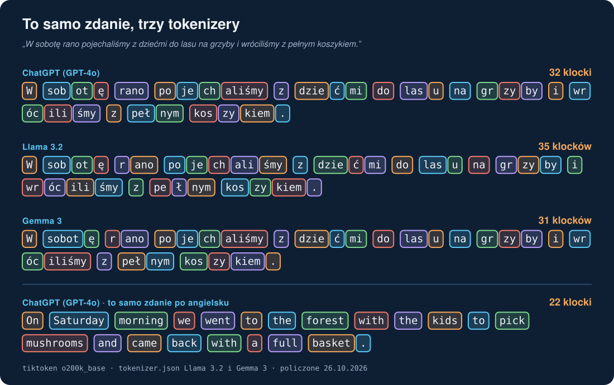
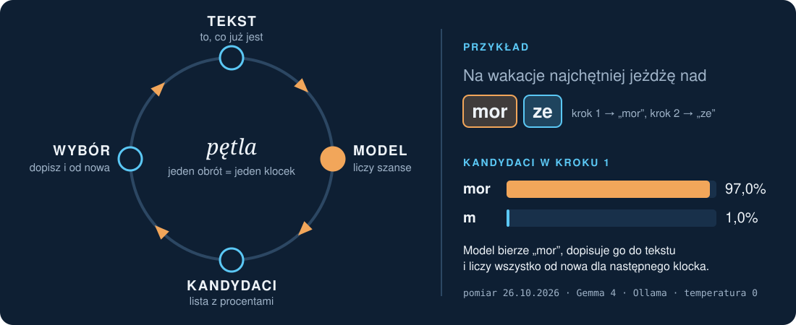
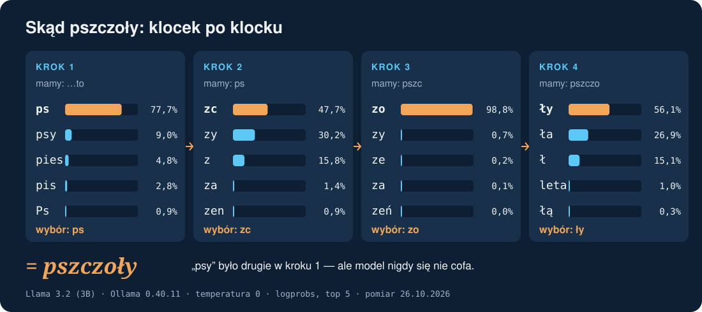
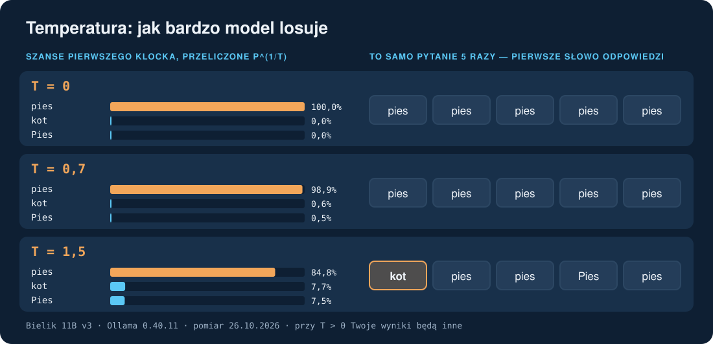

# 🧠 AI od zera #1 — Czym jest LLM i czym są tokeny

[]()
[](https://youtu.be/EGYjK3ZXgjY)
[]()
[]()

> 🎯 Po tym przewodniku wiesz, co dzieje się w środku, gdy czat z AI „pisze” odpowiedź: tekst jest cięty na klocki
> (tokeny), model zgaduje następny klocek, a temperatura decyduje, jak bardzo losuje. Wiesz też, czemu po polsku
> zużywasz więcej tokenów i dlaczego AI potrafi pewnym tonem powiedzieć coś zmyślonego. 🇬🇧 [English version](01-llm-and-tokens.md)

> 📺 Film: [AI od zera #1](https://youtu.be/EGYjK3ZXgjY) · rozdziały: [tokeny 2:00](https://youtu.be/EGYjK3ZXgjY?t=120) · [halucynacje 3:34](https://youtu.be/EGYjK3ZXgjY?t=214) · [temperatura 4:46](https://youtu.be/EGYjK3ZXgjY?t=286)

**Sprawdzone na:** Ollama 0.40.11 · Bielik 11B v3 · Gemma 4 · Llama 3.2 (3B) · tokenizery GPT-4o (`o200k_base`),
Llama 3.2, Gemma 3 · pomiar 26.10.2026. Całe „Zrób sam” przeszliśmy 27.10.2026 jeszcze raz **na czystym Windows 10 22H2**
(Windows PowerShell 5.1, bez karty graficznej, bez wcześniej zainstalowanych programów) — wszystkie wyniki się zgadzają.

---

## 🎬 Co było w filmie (w skrócie)

1. LLM to „podpowiedzi z klawiatury telefonu” na ogromną skalę: zgaduje, co będzie dalej.
2. Odpowiedź powstaje w pętli: tekst → model liczy szanse → wybiera klocek → dopisuje → od nowa.
3. Model nie widzi liter ani słów, tylko **tokeny** (klocki). Po polsku jest ich więcej niż po angielsku.
4. Trening ustawia miliardy „pokręteł” (wag); w czasie rozmowy są zamrożone.
5. Zmyślenia (halucynacje) biorą się z tego, że model wybiera klocek, który *pasuje*, a nie sprawdza, czy to *prawda*.
6. Temperatura ustawia, jak bardzo model losuje.

## 📖 Słowa, których potrzebujesz

LLM · token · tokenizer · prawdopodobieństwo · waga · trening · halucynacja · temperatura — krótkie definicje
w [słowniczku](glossary_PL.md).

## 🧱 1. Tokeny: jak tekst zamienia się w klocki

Zanim model cokolwiek „przeczyta”, tekst przechodzi przez **tokenizer** — część, która tnie go na klocki z gotowego
słownika. Słownik powstaje raz, przed treningiem: najczęstsze kawałki tekstu dostają własny klocek. Skoro tekstów
po angielsku było najwięcej, angielskie słowa zwykle mieszczą się w jednym klocku („mushrooms”, „Saturday”).
Polskie słowa, z odmianą i znakami „ą, ę, ż”, częściej trzeba składać z kilku kawałków: „jeżdżę” to w GPT-4o aż
„je | ż | d | ż | ę”. Spacja zwykle należy do klocka, który po niej stoi („ rano”, „ las”). Każda rodzina modeli
ma swój słownik, dlatego to samo zdanie daje różne liczby w różnych kolumnach tabeli.

**Pomiar — ile klocków ma to samo zdanie (PL / EN):**

| Zdanie | GPT-4o | Llama 3.2 | Gemma 3 |
|---|---|---|---|
| „W sobotę rano pojechaliśmy z dziećmi do lasu na grzyby i wróciliśmy z pełnym koszykiem.” / EN | **32 / 22** | 35 / 22 | 31 / 22 |
| „Na wakacje najchętniej jeżdżę nad morze.” / EN | 17 / 11 | 18 / 11 | 16 / 11 |
| „Najlepsze zwierzę domowe to pies.” / EN | 12 / 7 | 13 / 7 | 10 / 7 |

- Po polsku wychodzi **od 1,4 do 1,9 raza więcej** klocków niż po angielsku (zależnie od zdania i modelu; w filmie
  w zaokrągleniu „półtora do dwóch razy”).
- „Jeżdżę” to w GPT-4o **5 klocków**; „pies” i „dog” — po jednym.



**Co to dla Ciebie znaczy:** limity w czatach, koszty API i długość „pamięci” rozmowy liczy się w tokenach —
po polsku ta sama rozmowa szybciej dochodzi do limitu. To nie powód, żeby rezygnować z polskiego. Po prostu dobrze to
wiedzieć.

Przykład na liczbach z tabeli: rozmowa, która po angielsku zajęłaby 1000 klocków, po polsku zajmie mniej więcej
1400–1900. Jeśli czat ma limit wiadomości liczony w tokenach albo płacisz za tokeny w API, po polsku zmieścisz w nim
mniej treści. To samo dotyczy „pamięci” rozmowy — więcej o niej w odcinku 2. Cen nie podajemy, bo zmieniają się
częściej niż ten przewodnik.

## 🎯 2. Zgadywanie następnego klocka

Model nie „wie”, jakie słowo będzie dalej. W każdym kroku liczy **szansę w procentach** dla wszystkich klocków
ze słownika naraz (w Llamie 3.2 to 128 256 klocków) — a wszystkie szanse razem dają 100%. Potem jeden klocek wybiera, dopisuje go na koniec tekstu i liczy
wszystko od nowa, już z tym nowym klockiem. Odpowiedź z czatu to kilkaset takich obrotów pętli, dlatego pojawia się
na ekranie kawałek po kawałku. Ollama potrafi pokazać pięciu najlepszych kandydatów w każdym kroku — to właśnie
ćwiczenie 2 niżej.



**Pomiar — pierwszy klocek odpowiedzi (temperatura 0):**

| Początek zdania | Bielik 11B v3 | Gemma 4 | Llama 3.2 (3B) |
|---|---|---|---|
| „Najlepsze zwierzę domowe to…” | **pies** („p” 84,1%) | **Zależy** („Z” 23,1%) | **pszczoły** („ps” 77,7%) |
| „Na wakacje najchętniej jeżdżę nad…” | morze („mor” 61,9%) | morze („mor” 97,0%) | morską („m” 72,8%) |

Ten sam klocek „mor” jeden model wybiera z pewnością 97%, a inny 62% — modele różnią się nie tylko odpowiedzią,
ale i tym, jak bardzo są jej „pewne”.

## 🐝 3. Skąd się wzięły pszczoły (krok po kroku)

| Krok | Mamy już | Kandydaci (Llama 3.2, temperatura 0) | Wybór |
|---|---|---|---|
| 1 | „…to” | „ps” 77,7% | ps |
| 2 | „ps” | „zc” 47,7% · „zy” 30,2% | **zc** — prawie rzut monetą |
| 3 | „pszc” | „zo” 98,8% | zo |
| 4 | „pszczo” | „ły” 56,1% | ły → **pszczoły** |



Model nie umie się cofnąć: po wybraniu „zc” najlepiej pasującym dalszym ciągiem są już pszczoły, nie psy.

To samo dzieje się przy zwykłych pytaniach. Model dobiera klocki, które **pasują**, więc data, nazwisko, liczba
czy tytuł książki mogą wyglądać wiarygodnie i być nieprawdziwe — a ton odpowiedzi jest tak samo pewny jak przy
prawdzie. Takie zmyślenia nazywa się halucynacjami.

**Jak sprawdzać (lista na co dzień):**

- Fakty, liczby, daty, nazwiska, cytaty i linki — sprawdź w źródle, zanim ich użyjesz.
- Poproś o źródło i otwórz je. Link, który nie działa albo mówi coś innego, to sygnał ostrzegawczy.
- Zadaj to samo pytanie w nowej rozmowie albo innemu modelowi. Różne odpowiedzi = model zgaduje.
- Im rzadszy temat (mała miejscowość, niszowy przepis, świeże wydarzenie), tym ostrożniej.
- Pewny ton to nie dowód.

## 🧊 4. Trening a używanie

W środku modelu są miliardy liczb — **wag**. Na filmie to „pokrętła”: każde trochę przesuwa szanse klocków.
**Trening** to długie ustawianie tych pokręteł na ogromnej ilości tekstu, robione raz, zanim model trafi do ludzi.
Potem pokrętła są zamrożone: w czasie rozmowy z Tobą model się nie uczy i nie zagląda do żadnej bazy faktów,
tylko liczy szanse na podstawie tego, co ma w wagach. Dlatego nie wie, co wydarzyło się po zakończeniu treningu —
ten moment nazywa się **datą odcięcia wiedzy**. Widać to w naszych liczbach: plik modelu Llama 3.2 ma 2,0 GB
i przy temperaturze 0 (po `ollama stop`) za każdym razem daje dokładnie te same procenty — nic się w nim między pytaniami nie zmienia.

**Czego film nie mówił:** wiele aplikacji czatu dokłada wokół modelu narzędzia — wyszukiwanie w internecie,
czytanie Twoich plików, zapamiętywanie notatek o Tobie. Wtedy odpowiedź może zawierać świeże informacje, ale wagi
modelu nadal się nie zmieniają: aplikacja po prostu dokleja znaleziony tekst do rozmowy. Jak to działa, zobaczysz
w odcinku 2 (kontekst) i 4 (od czatu do agenta). Lokalny model w Ollamie z tego przewodnika takich narzędzi nie ma.

## 🌡️ 5. Temperatura

**Wzór (dla chętnych):** szansa klocka przy temperaturze T to p^(1/T), przeliczone tak, żeby suma dała 100%.
Przy T → 0 najlepszy klocek dostaje 100%; im wyższa T, tym bardziej szanse się wyrównują.

Przykład z pomiaru (Bielik, 3 najlepsze klocki pierwszego słowa, przeliczenie):

| Temperatura | „p…” (pies) | „k…” (kot) | „P…” (Pies) |
|---|---|---|---|
| 0 | 100% | 0% | 0% |
| 1,5 | 84,8% | 7,7% | 7,5% |



**Pomiar — to samo pytanie 5 razy („Najlepsze zwierzę domowe to…”, pierwsze słowo odpowiedzi):**

| Model | T = 0 | T = 0,7 | T = 1,5 |
|---|---|---|---|
| Bielik 11B v3 | pies ×5 | pies ×5 | **kot**, pies, pies, Pies, pies |
| Gemma 4 | Zależy ×5 | Zależy / To zależy | To zależy, Idealne, tobie, **sobój**, Zależy |
| Llama 3.2 (3B) | pszczoły ×5 | pszy, pszy, psy, pszczoły, pszczoły | psy, psy, pszy, pszy, pies |

Przy temperaturze 0 wynik jest za każdym razem ten sam; przy wyższej zmienia się przy każdym uruchomieniu — Twoje
wyniki będą inne i to jest w porządku.

**Inne pokrętła losowania (dla chętnych).** Oprócz temperatury Ollama ma m.in. **`top_k`** — losuje tylko spośród
k najlepszych klocków (domyślnie 40) — i **`top_p`** — bierze najlepsze klocki, aż ich szanse razem dojdą do p
(domyślnie 0,9); niższe wartości dają odpowiedzi ostrożniejsze, wyższe — bardziej różnorodne. Jest też **`seed`**:
ta sama liczba przy tym samym pytaniu daje ten sam tekst nawet przy losowaniu. Uwaga: model może mieć **własne
ustawienia domyślne**. Sprawdzisz je poleceniem `ollama show <model> --parameters` — u nas Bielik ma `temperature 0.1`,
Gemma 4 `temperature 1`, `top_k 64`, `top_p 0.95`, a Llama 3.2 nie ustawia nic, więc Ollama bierze swoje
`temperature 0.8`. Dlatego `ollama run llama3.2` potrafi odpowiedzieć „pszczółka”, a nie „pszczoły” (zob. instalacja).

## 🗄️ Z mojej pracy

„Najlepsza baza danych to…”: Bielik — **PostgreSQL**, Llama 3.2 — **MySQL**, Gemma 4 — zaczyna od powtórzenia pytania.
Trzy modele, trzy różne „pewne” odpowiedzi — dlatego każdy skrypt od AI sprawdzam, zanim go uruchomię.

A teraz zajrzyjmy do środka: Bielik wybrał „Post” (początek „PostgreSQL”) z szansą zaledwie **25,7%**, a Llama
„MySQL” z szansą **17,1%**. Odpowiedź w czacie wyglądałaby tak samo pewnie jak przy „pies” z 84%, a tak naprawdę
model był daleko od pewności. Na co dzień jestem administratorem baz danych i AI realnie mi pomaga — pisze
skrypty, szuka błędów. Ale skrypt, który ma działać na prawdziwej bazie, najpierw czytam i uruchamiam na próbnej.
Tak samo warto traktować każdą odpowiedź AI w ważnej sprawie.

## 🛠️ Zrób sam

### Poziom 1 — bez instalacji

#### Ćwiczenie A — tokenizer w przeglądarce (link z filmu)

1. Otwórz **https://platform.openai.com/tokenizer** — to oficjalne narzędzie OpenAI, działa bez logowania
   (okienko o ciasteczkach możesz zamknąć przyciskiem odrzucenia).
2. Zostaw zaznaczoną pierwszą zakładkę, **„GPT-5.x & O1/3”**. Nie ma tam zakładki z nazwą GPT-4o, ale ta daje dokładnie
   ten sam podział co GPT-4o w filmie — sprawdziliśmy to na wszystkich trzech przykładach niżej. Zakładki „legacy” to
   starsze modele i liczą inaczej.
3. Wklej zdanie i odczytaj **Tokens** i **Characters**. Pod licznikiem zobaczysz kolorowe klocki — te same, co w filmie
   (przełącznik **Token IDs** pokazuje zamiast nich numery klocków).

| Wklej | Nasz wynik (Tokens / Characters) |
|---|---|
| `W sobotę rano pojechaliśmy z dziećmi do lasu na grzyby i wróciliśmy z pełnym koszykiem.` | **32** / 87 |
| `On Saturday morning we went to the forest with the kids to pick mushrooms and came back with a full basket.` | **22** / 107 |
| `jeżdżę` | **5** / 6 |

Sprawdzone 26.10.2026. Wklejaj tekst (Ctrl+V), nie przepisuj — jedna literówka i liczby się rozjadą.

**Policz sam:** OpenAI podaje na tej stronie regułę, że w angielskim tekście jeden token to średnio około 4 znaków.
Z naszego zdania wychodzi: po angielsku 107 / 22 ≈ **4,9** znaku na klocek, po polsku 87 / 32 ≈ **2,7**. Ten sam tekst
po polsku jest po prostu „droższy” w tokenach. Wklej kilka swoich zdań (mail, wiadomość, przepis) i porównaj.

#### Ćwiczenie B — to samo pytanie kilka razy

Zadaj czatowi AI (dowolnemu) to samo pytanie 3–5 razy, **za każdym razem w nowej rozmowie**, np. „Dokończ zdanie
jednym słowem: Najlepsze zwierzę domowe to”. Zapisz odpowiedzi. Czaty zwykle trochę losują (temperatura większa od zera),
więc odpowiedzi mogą się różnić — dokładnie jak w filmie.

### Poziom 2 — lokalny model (Ollama): dokładnie nasze komendy i nasze wyniki

Poniżej są **dokładnie te zapytania, z tymi samymi parametrami**, z których powstały liczby w filmie. Pod każdą komendą
jest **nasz wynik** skopiowany z prawdziwego uruchomienia (26.10.2026, Ollama 0.40.11, Windows 11, karta graficzna
NVIDIA). Uruchom u siebie i porównaj.

> ⚠️ **Polskie znaki.** Zapytanie wysyłamy jako plik JSON w UTF-8 (Bash) albo jako bajty UTF-8 (PowerShell).
> Wklejenie polskiego tekstu prosto do argumentu `curl` w Git Bash potrafi popsuć litery — model dostaje wtedy inny
> tekst i wyniki są fałszywe (tak było przy naszej pierwszej próbie).

#### 0. Instalacja Ollamy i modeli

[Ollama](https://ollama.com) to darmowy program, który uruchamia modele językowe **na Twoim komputerze** — bez konta,
bez wysyłania tekstu do internetu (internet potrzebny jest tylko do pobrania programu i modeli). Działa w tle i odpowiada
pod adresem `http://localhost:11434`. Na samym procesorze też działa, tylko wolniej niż z kartą graficzną.

**Windows** (10 22H2 lub nowszy, 11) — wybierz jedną drogę:

```powershell
# A) instalator do pobrania (najprościej, nie wymaga uprawnień administratora):
#    https://ollama.com/download -> OllamaSetup.exe -> uruchom

# B) PowerShell — oficjalny skrypt (pobiera i uruchamia ten sam OllamaSetup.exe):
irm https://ollama.com/install.ps1 | iex

# C) winget (menedżer pakietów Windows):
winget install --id Ollama.Ollama --exact
```

> 🛡️ Droga B uruchamia skrypt prosto z internetu. Dobry nawyk (wróci w odcinku o bezpieczeństwie): najpierw go
> przeczytaj — `irm https://ollama.com/install.ps1` wypisze go na ekran, nic nie uruchamiając. Co w nim jest (sprawdziliśmy
> 27.10.2026): pobiera `OllamaSetup.exe`, **sprawdza jego podpis cyfrowy** (musi być „Ollama Inc.”, inaczej przerywa),
> instaluje go po cichu tylko dla Twojego konta (`%LOCALAPPDATA%\Programs\Ollama`, bez uprawnień administratora) i uruchamia
> Ollamę w tle. Długi blok `# SIG # Begin signature block` na końcu to podpis samego skryptu — nie musisz go czytać.

**Nasz wynik drogi B** (czysty Windows 10, ok. 5 minut, bez żadnego okna i bez pytań):

```text
>>> Downloading Ollama for Windows...
######################################## 100.0%
>>> Installing Ollama...
>>> Install complete. Run 'ollama' from the command line.
```

Po instalacji Ollama działa w tle; jej ikona (lama) siedzi przy zegarze — w Windows 10 zwykle **schowana pod strzałką ^**.

**macOS:** pobierz `Ollama.dmg` z https://ollama.com/download albo w Terminalu:

```bash
curl -fsSL https://ollama.com/install.sh | sh
```

**Linux:**

```bash
curl -fsSL https://ollama.com/install.sh | sh
```

**Sprawdź, że działa** — Windows (PowerShell):

```powershell
ollama --version
curl.exe -s http://localhost:11434/api/version
```

macOS / Linux (Bash): to samo, tylko `curl -s` zamiast `curl.exe -s`.

**Nasz wynik:** `ollama version is 0.40.11` i `{"version":"0.40.11"}`. Potrzebna jest wersja z obsługą `logprobs`,
czyli **0.12.11 lub nowsza** (my mieliśmy 0.40.11 — z nią sprawdziliśmy wszystkie komendy niżej). Na Windows pisz **`curl.exe`**: w Windows PowerShell 5.1
(tym, który jest w systemie od początku) samo `curl` to inne polecenie i zamiast odpowiedzi zapyta o `Uri:` (patrz „Typowe błędy”).

**Pobierz modele z odcinka** (jednorazowo; rozmiary z naszego `ollama list`):

```powershell
ollama pull llama3.2                                    # 2,0 GB
ollama pull SpeakLeash/bielik-11b-v3.0-instruct:Q4_K_M  # 6,7 GB — polski model
ollama pull gemma4                                      # 9,6 GB — opcjonalnie
ollama list
```

Każde pobranie kończy się linijkami `verifying sha256 digest`, `writing manifest`, `success`. Przy dużym modelu
**`verifying sha256 digest` potrafi stać kilka–kilkanaście minut bez żadnego paska** (Ollama sprawdza, czy plik doszedł
cały) — to nie zawieszenie, nie przerywaj. Na czystym Windows 10 w maszynie wirtualnej: Llama 3.2 ok. 3,5 minuty,
Bielik ok. 25 minut (w tym ok. 13 minut samego sprawdzania).

Modele trafiają do katalogu `.ollama` w Twoim katalogu domowym; inne miejsce ustawisz zmienną środowiskową
`OLLAMA_MODELS` (potem zamknij i uruchom Ollamę ponownie).

**Pierwsza rozmowa:**

```powershell
ollama run llama3.2 "Dokończ zdanie jednym słowem: Najlepsze zwierzę domowe to"
```

**Nasz wynik:** `pszczółka.` — a w filmie było „pszczoły”; na drugim komputerze wyszło `pszy.`, a potem `pszczoła.`.
To nie błąd: `ollama run` używa domyślnych ustawień modelu, w tym temperatury większej od zera, więc trochę losuje. Dlatego w ćwiczeniach niżej pytamy przez API z `temperature: 0`
— tylko tak możesz porównać swój wynik z naszym co do procenta.

Do wersji Bash ćwiczeń potrzebny jest też `jq` (czytelny wynik z JSON): Linux `sudo apt install jq`, macOS
`brew install jq`, Windows `winget install jqlang.jq`.

#### Ćwiczenie 1 — ile tokenów ma zdanie (Llama 3.2)

`raw: true` wysyła tekst bez dodatków czatu, więc Ollama liczy tylko nasze zdanie **plus 1 token startowy**.

**PowerShell**

```powershell
$body = @{
  model   = "llama3.2"
  prompt  = "W sobotę rano pojechaliśmy z dziećmi do lasu na grzyby i wróciliśmy z pełnym koszykiem."
  raw     = $true
  stream  = $false
  options = @{ num_predict = 1 }
} | ConvertTo-Json -Depth 5
$r = Invoke-RestMethod -Uri "http://localhost:11434/api/generate" -Method Post `
       -ContentType "application/json; charset=utf-8" -Body ([Text.Encoding]::UTF8.GetBytes($body))
"prompt_eval_count = $($r.prompt_eval_count)  ->  tokens = $($r.prompt_eval_count - 1)"
```

**Bash** (Linux, macOS, Git Bash)

```bash
cat > count.json <<'EOF'
{
  "model": "llama3.2",
  "prompt": "W sobotę rano pojechaliśmy z dziećmi do lasu na grzyby i wróciliśmy z pełnym koszykiem.",
  "raw": true,
  "stream": false,
  "options": { "num_predict": 1 }
}
EOF
curl -s http://localhost:11434/api/generate -H "Content-Type: application/json" \
     --data-binary @count.json | jq '.prompt_eval_count - 1'
```

Wklejony blok PowerShell pokazuje na początku kolejnych linii `>>` — to zwykłe „ciąg dalszy komendy”, nie błąd.

**Nasz wynik:** `prompt_eval_count = 36  ->  tokens = 35` (Bash: `35`) — tyle, ile w tabeli dla Llamy 3.2.
Ta liczba nie zależy od komputera: na czystym Windows 10 bez karty graficznej wyszło tak samo.
Zamień zdanie na angielskie z tabeli: wyjdzie **22**.

#### Ćwiczenie 2 — kandydaci na następny klocek: skąd pszczoły (Llama 3.2)

`logprobs` + `top_logprobs: 5` każe Ollamie zwrócić 5 najlepszych kandydatów w każdym kroku, `temperature: 0` wyłącza
losowanie, `num_predict: 4` = 4 klocki odpowiedzi.

> 💡 **Najpierw `ollama stop llama3.2`.** Gdy zadasz to samo pytanie drugi raz bez zatrzymania modelu, Ollama użyje
> zapamiętanego początku rozmowy i liczy go trochę inaczej: u nas wyszło wtedy 78,1% → 45,4% zamiast 77,7% → 47,7%.
> Odpowiedź („pszczoły”) zostaje ta sama, zmieniają się tylko końcowe cyfry. Na innym komputerze (inna karta graficzna,
> sam procesor) procenty też mogą się różnić o kilka punktów — liczy się odpowiedź i kolejność głównych kandydatów.
> Kandydaci z prawie równymi szansami (np. 1,2% i 1,2%) mogą zamienić się miejscami.
> Procenty przesuwa też inna wersja Ollamy albo modelu: na tym samym laptopie, po tym jak Ollama sama zaktualizowała
> się z 0.40.11 do 0.40.13 (30.10.2026), wyszło „ły” 49,1% zamiast 56,1% i „ps” 76,2% zamiast 77,7%. Odpowiedzi
> przy T = 0 i kolejność kandydatów zostały te same.

**PowerShell**

```powershell
ollama stop llama3.2
$body = @{
  model        = "llama3.2"
  prompt       = "Dokończ zdanie jednym słowem: Najlepsze zwierzę domowe to"
  stream       = $false
  think        = $false
  logprobs     = $true
  top_logprobs = 5
  options      = @{ num_predict = 4; temperature = 0 }
} | ConvertTo-Json -Depth 5
$r = Invoke-RestMethod -Uri "http://localhost:11434/api/generate" -Method Post `
       -ContentType "application/json; charset=utf-8" -Body ([Text.Encoding]::UTF8.GetBytes($body))
"Odpowiedź: $($r.response)"
foreach ($step in $r.logprobs) {
  ($step.top_logprobs | ForEach-Object { "{0} {1:N1}%" -f $_.token, ([math]::Exp($_.logprob) * 100) }) -join "  |  "
}
```

**Bash**

```bash
ollama stop llama3.2
cat > request.json <<'EOF'
{
  "model": "llama3.2",
  "prompt": "Dokończ zdanie jednym słowem: Najlepsze zwierzę domowe to",
  "stream": false,
  "think": false,
  "logprobs": true,
  "top_logprobs": 5,
  "options": { "num_predict": 4, "temperature": 0 }
}
EOF
curl -s http://localhost:11434/api/generate -H "Content-Type: application/json" \
     --data-binary @request.json > response.json
jq -r '.response' response.json
jq -r '.logprobs[] | [.top_logprobs[] | "\(.token) \((.logprob | exp) * 1000 | round / 10)%"] | join("  |  ")' response.json
```

**Nasz wynik:**

```text
Odpowiedź: pszczoły
ps 77,7%  |  psy 9,0%  |  pies 4,8%  |  pis 2,8%  |  Ps 0,9%
zc 47,7%  |  zy 30,2%  |  z 15,8%  |  za 1,4%  |  zen 0,9%
zo 98,8%  |  zy 0,7%  |  ze 0,2%  |  za 0,1%  |  zeń 0,0%
ły 56,1%  |  ła 26,9%  |  ł 15,1%  |  leta 1,0%  |  łą 0,3%
```

Bash pokazuje te same liczby z kropką i bez końcowego zera (`77.7%`, `9%`). Widać tu cały film w czterech linijkach: „psy” było drugie (9%), a w drugim kroku „zc” wygrało z „zy” niemal rzutem monetą.

**Nasz wynik na samym procesorze** (czysty Windows 10, bez karty graficznej) — ta sama odpowiedź, ci sami trzej główni
kandydaci w każdym kroku, procenty inne o 0,2–3 punkty, a w drugim kroku miejsca 4 i 5 zamieniły się (prawie remis):

```text
Odpowiedź: pszczoły
ps 76,6%  |  psy 10,2%  |  pies 4,6%  |  pis 2,6%  |  Ps 1,2%
zc 46,8%  |  zy 32,0%  |  z 14,1%  |  zen 1,2%  |  za 1,2%
zo 99,0%  |  zy 0,6%  |  ze 0,2%  |  za 0,1%  |  zeń 0,0%
ły 53,0%  |  ła 29,4%  |  ł 15,8%  |  leta 0,9%  |  łą 0,3%
```
Zmień `model` na `SpeakLeash/bielik-11b-v3.0-instruct:Q4_K_M` (wynik: **pies**, „p” 84,1%; pierwszy krok Bielika to nowa
linia) albo `gemma4` (wynik: **Zależy**).

#### Ćwiczenie 3 — temperatura: to samo pytanie 5 razy (Bielik 11B)

**PowerShell**

```powershell
foreach ($t in 0, 1.5) {
  $body = @{
    model   = "SpeakLeash/bielik-11b-v3.0-instruct:Q4_K_M"
    prompt  = "Dokończ zdanie jednym słowem: Najlepsze zwierzę domowe to"
    stream  = $false
    think   = $false
    options = @{ num_predict = 12; temperature = $t }
  } | ConvertTo-Json -Depth 5
  "T = $t"
  1..5 | ForEach-Object {
    $r = Invoke-RestMethod -Uri "http://localhost:11434/api/generate" -Method Post `
           -ContentType "application/json; charset=utf-8" -Body ([Text.Encoding]::UTF8.GetBytes($body))
    "  " + ($r.response.Trim() -split "`n")[0]
  }
}
```

**Bash**

```bash
for T in 0 1.5; do
  cat > temp.json <<EOF
{
  "model": "SpeakLeash/bielik-11b-v3.0-instruct:Q4_K_M",
  "prompt": "Dokończ zdanie jednym słowem: Najlepsze zwierzę domowe to",
  "stream": false,
  "think": false,
  "options": { "num_predict": 12, "temperature": $T }
}
EOF
  echo "T = $T"
  for i in 1 2 3 4 5; do
    curl -s http://localhost:11434/api/generate -H "Content-Type: application/json" \
         --data-binary @temp.json | jq -r '.response | ltrimstr("\n") | split("\n")[0]'
  done
done
```

**Nasz wynik** (drugie uruchomienie, 26.10.2026 wieczorem):

```text
T = 0
  pies. Pies jest najlepszym przy
  pies. Pies jest najlepszym przy
  pies. Pies jest najlepszym przy
  pies. Pies jest najlepszym przy
  pies. Pies jest najlepszym przy
T = 1.5
  pies.
  Pies.
  pies. Pies jest często uważ
  pies. Pies jest często uważ
  Pies. Jest to najczęśc
```

Przy T = 0 wynik jest za każdym razem identyczny — także na samym procesorze (czysty Windows 10: pięć razy
`pies. Pies jest najlepszym przy`, całe ćwiczenie ok. 2 minut z ładowaniem modelu). Przy T = 1,5 **Twój wynik będzie inny niż nasz** i inny przy każdym
uruchomieniu — to właśnie losowanie. W pomiarze do filmu raz wypadł „kot”; w uruchomieniu powyżej ani razu, a w teście
wersji Bash tego samego wieczoru znów raz („kot. Koty są niezależne”).
Odpowiedź urywa się w pół słowa, bo `num_predict: 12` ucina ją po 12 klockach — nam wystarczało pierwsze słowo.

#### Ćwiczenie 4 — klocki ChatGPT (GPT-4o) w Pythonie

To ćwiczenie potrzebuje **Pythona**. Sprawdź, czy go masz: `python --version`. Na czystym Windowsie zamiast wersji
zobaczysz `nie znaleziono Python; uruchom bez argumentów, aby zainstalować…` (Windows sam podsuwa Sklep Microsoft).
Zainstaluj go jedną komendą:

```powershell
winget install --id Python.Python.3.12 --exact
```

(macOS: `brew install python`; Linux zwykle ma Pythona — `python3 --version`.) Przy pierwszym użyciu `winget` może zapytać
o zgodę na warunki źródła `msstore` — odpowiedz `Y`. Po instalacji **zamknij PowerShell i otwórz go na nowo** — w starym
oknie `python` dalej pokazuje komunikat o Sklepie. W nowym `python --version` → `Python 3.12.10` (u nas ok. 2 minut).

Potem biblioteka z tokenizerem GPT-4o:

```powershell
python -m pip install tiktoken
```

Na końcu może pojawić się `[notice] A new release of pip is available…` — to tylko informacja, możesz ją zignorować.

Zapisz kod jako `gpt4o_tokens.py` (w Notatniku: *Zapisz jako* → typ „Wszystkie pliki”, kodowanie UTF-8) i uruchom `python gpt4o_tokens.py`:

```python
import tiktoken

enc = tiktoken.get_encoding("o200k_base")          # the tokenizer of GPT-4o
for text in ["W sobotę rano pojechaliśmy z dziećmi do lasu na grzyby i wróciliśmy z pełnym koszykiem.",
             "On Saturday morning we went to the forest with the kids to pick mushrooms and came back with a full basket.",
             "jeżdżę"]:
    ids = enc.encode(text)
    print(len(ids), "|".join(enc.decode([i]) for i in ids))
```

**Nasz wynik:**

```text
32 W| sob|ot|ę| rano| po|je|ch|aliśmy| z| dzie|ć|mi| do| las|u| na| gr|zy|by| i| wr|óc|ili|śmy| z| peł|nym| kos|zy|kiem|.
22 On| Saturday| morning| we| went| to| the| forest| with| the| kids| to| pick| mushrooms| and| came| back| with| a| full| basket|.
5 je|ż|d|ż|ę
```

Ten wynik nie zależy od komputera: tokenizer to stała tabela, więc musisz dostać **dokładnie** to samo.

**Ścieżka skryptowa** — wszystkie pomiary z filmu jednym poleceniem: [`episodes/01-llm-and-tokens/`](../episodes/01-llm-and-tokens/) (`tokens.py`, `next_token.py`, opis uruchomienia w [README_PL](../episodes/01-llm-and-tokens/README_PL.md) tamtego katalogu).
Sprawdziliśmy to sami: ponowne uruchomienie 26.10.2026 dało **identyczne** liczniki, kandydatów i odpowiedzi przy
temperaturze 0 jak pomiar do filmu (różniły się tylko próby przy T > 0 — i tak ma być). To było na tej samej
Ollamie 0.40.11. Po aktualizacji do 0.40.13 (30.10.2026) liczniki, kolejność kandydatów i odpowiedzi przy
temperaturze 0 nadal były identyczne, ale procenty Llamy 3.2 i Bielika przesunęły się o kilka punktów
(Gemma 4: bez zmian) — liczby w filmie to zdjęcie jednej wersji.

## ⚠️ Typowe błędy

Zebrane przy przygotowaniu tego przewodnika (26.10.2026) i przy teście na czystym Windows 10 (27.10.2026).

| Co widzisz | Dlaczego | Co zrobić |
|---|---|---|
| `{"error":"model 'llama3.3' not found"}` | model nie jest pobrany albo literówka w nazwie | `ollama list`, potem `ollama pull <nazwa>` |
| `Error: pull model manifest: file does not exist` (przy `ollama run`) | nie ma takiego modelu w bibliotece Ollamy | sprawdź nazwę na ollama.com/library |
| `curl` nic nie wypisuje (kod wyjścia 7), PowerShell: „Nie można nawiązać połączenia, ponieważ komputer docelowy aktywnie go odmawia” | Ollama nie działa | uruchom aplikację Ollama (Windows: ikona przy zegarze) albo `ollama serve` |
| procenty różnią się od naszych na ostatnich cyfrach (np. 78,1% zamiast 77,7%) | to samo pytanie zadane drugi raz — Ollama użyła pamięci podręcznej | `ollama stop <model>` i powtórz |
| procenty różnią się od naszych o kilka punktów, odpowiedź ta sama | inna wersja Ollamy albo modelu (`ollama pull` pobiera najnowszą) | nic do naprawy — porównuj odpowiedź i kolejność kandydatów, nie końcowe cyfry |
| liczba tokenów wyższa niż w tabeli, dziwne znaki zamiast „ą, ę” | polski tekst wklejony wprost do `curl` w Git Bash | wysyłaj z pliku JSON (`--data-binary @plik`) albo z PowerShella |
| `ollama run` daje inną odpowiedź niż w filmie | domyślna temperatura modelu > 0 | porównuj przez API z `"temperature": 0` (ćwiczenia 2–3) |
| brak pola `logprobs` w odpowiedzi | za stara Ollama — `logprobs` są od wersji **0.12.11** (listopad 2025) | `ollama --version`, zaktualizuj Ollamę; my mieliśmy 0.40.11 |
| tokenizer w przeglądarce pokazuje inną liczbę | inna zakładka albo przepisany (nie wklejony) tekst | zakładka „GPT-5.x & O1/3”, wklej Ctrl+V |
| po `curl -s …` PowerShell pisze `Supply values for the following parameters:` i czeka na `Uri:` | w Windows PowerShell 5.1 `curl` to inne polecenie (`Invoke-WebRequest`) | Ctrl+C, potem `curl.exe -s …` |
| `ollama pull` długo stoi na `verifying sha256 digest` | Ollama sprawdza duży plik modelu, bez paska postępu | poczekaj (u nas do ok. 13 minut), nie przerywaj |
| nie widzę ikony Ollamy przy zegarze | Windows chowa nowe ikony | kliknij strzałkę ^ obok zegara |
| `nie znaleziono Python; uruchom bez argumentów, aby zainstalować…` | Pythona nie ma albo instalujesz go w tym samym oknie | `winget install --id Python.Python.3.12 --exact`, potem **nowe okno** PowerShell |
| w komendzie brakuje „ą, ę, ł…” (np. „Dokocz” zamiast „Dokończ”) | stara konsola Windows 10 przy wklejaniu prawym przyciskiem myszy | wklejaj **Ctrl+V** |

## 🔬 Metoda i wersje

- Wszystkie liczby: pomiar lokalny 26.10.2026, Ollama 0.40.11; kandydaci przez `logprobs` + `top_logprobs: 5`,
  temperatura 0; próby temperatury: 5 na ustawienie.
- Klocki GPT-4o: biblioteka `tiktoken` (`o200k_base`); Llama 3.2 i Gemma 3: plik `tokenizer.json` (publiczne kopie).
  Liczby w Ollamie dla Gemmy pochodzą z Gemma 4 — w tabelach podpisujemy dokładnie, który model.
- Licznik Ollamy (`prompt_eval_count`) = liczba klocków + 1 klocek startowy; skrypt go odejmuje.
- Test „Zrób sam” 27.10.2026: czysty Windows 10 22H2 w maszynie wirtualnej (16 GB RAM, 8 rdzeni, bez karty graficznej),
  Windows PowerShell 5.1, Ollama 0.40.11 (droga B), Python 3.12.10 (winget). Wszystkie ćwiczenia przeszły; różnice
  tylko tam, gdzie je opisujemy (procenty na samym procesorze, losowanie przy T > 0).

## ➡️ Następny odcinek

**#2 Kontekst: model nie pamięta, tylko czyta** — skąd czat „pamięta” rozmowę, skoro tylko zgaduje dalszy ciąg tekstu.
